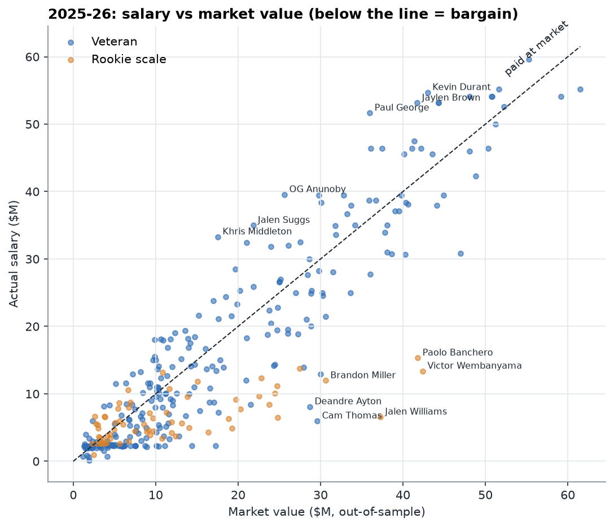
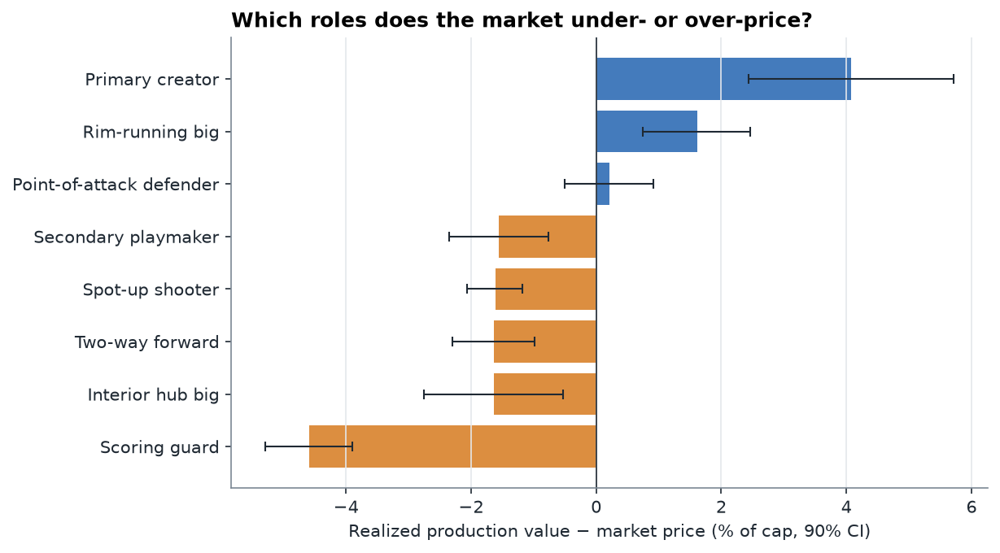
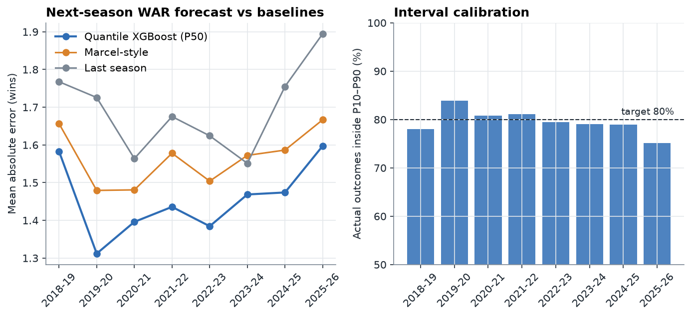

# NBA Contract Value

**Which NBA players are worth more than they're paid, and what will a roster be worth next season?**

An end-to-end model of player contract value built on Basketball-Reference stats, 17 seasons of
salaries (2009-10 to 2025-26), and actual 2026-27 contracts. It estimates three things for every player and validates
each one out of sample:

| Question | Model | Out-of-sample result |
|---|---|---|
| What would the open market pay for this player's track record? | Gradient-boosted trees with monotonic constraints, trained on veteran contracts | Average error **$4.0M**, R² **0.79**, rank correlation **0.85** (8 seasons) |
| What were his wins actually worth? | Wins above replacement priced at the league's own cost of a win | Team WAR vs actual wins: **r = 0.96** |
| What will he produce next season, and how sure are we? | Multi-quantile gradient boosting (P10 / P50 / P90) | Beats the Marcel baseline in **8 of 8** seasons; 80% intervals capture **79.7%** of outcomes |

Results, tables and every figure regenerate with one command; see [`outputs/REPORT.md`](outputs/REPORT.md).



## Findings

**The market pays for scoring volume, not impact.** Points and minutes per game are the largest drivers
of market value; two-year BPM ranks eleventh. That pattern is visible by role: across 1,951
veteran player-seasons, the market under-prices the realized production of primary creators
(+$6.6M per player per season, 90% CI $3.9M–$9.3M) and rim-running bigs (+$2.7M), and over-prices
scoring guards (−$7.6M, CI −$8.8M to −$6.5M).

**Efficient payrolls win.** Team-level realized surplus correlates 0.83 with wins in 2025-26. The
three most efficient rosters by the model (Oklahoma City, San Antonio, Detroit) were the league's
three best teams.

**Uncertainty is asymmetric for stars.** Luka Dončić projects at 16.6 WAR for 2026-27 with a P10 of
10.3 and a P90 of 18.5. Near a player's ceiling, most of the risk is availability rather than
performance, and a single point estimate hides that.

**The best-value veteran contract of 2026-27 is LeBron James in Philadelphia**: a P50 projection of
7.5 WAR on a $3.9M veteran minimum.



## Method

### Three lenses on value

- **Market value (ex-ante).** Predicts salary as a share of the cap from the two prior seasons of
  production, age, experience, draft slot and All-Star history. Trained **only on veteran contracts**:
  rookie-scale salaries are set by the CBA, not negotiated, so including them would teach the model
  that young stars are "worth" $10M. Applied to rookie-scale players, the model estimates what they
  would cost on the open market.
- **Realized value (ex-post).** WAR (VORP × 2.7) priced at that season's marginal cost of a win:
  league spending above replacement-level salary divided by league WAR ($4.5M per win in 2025-26).
  Replacement salary is the 10th-percentile rotation salary, which tracks the minimum-salary band at
  roughly 1.4% of the cap in every season.
- **Projected value.** P10/P50/P90 WAR forecasts for 2026-27, converted to dollars and compared with
  actual 2026-27 salaries.

Salaries are modeled as a **share of the cap**, since the cap grew from $57.7M (2009-10) to $165.0M
(2026-27).

### Validation design

- **Rolling-origin backtest.** Each season from 2018-19 to 2025-26 is predicted by a model trained
  only on earlier seasons. A random split would leak information, because one player's seasons would
  land in both train and test.
- **Leakage tests.** `tests/` corrupts every value from the target season and asserts that features
  and predictions do not change. The test was checked by injecting a leak and confirming it fails.
- **Baselines.** The market model is compared against ridge regression on all features and on four
  core stats. The forecast is compared against last season's WAR and a Marcel-style projection
  (5/4 weighting, 20% regression to the mean, standard age adjustment).
- **Calibration.** Interval coverage is checked per season, with misses split between the tails
  (10.6% below P10, 9.7% above P90).
- **Out-of-sample board.** The 2025-26 value board uses predictions from a model that never saw
  2025-26 salaries.



### Archetypes

KMeans (k = 8) on ten role statistics: usage, assist, rebounding, steal and block rates, shot
profile, efficiency and turnovers. Clusters are named by matching centroids to prototype profiles with
the Hungarian algorithm, so names stay stable when the model is refit. Separation is modest
(silhouette ≈ 0.12) because roles are a continuum; archetypes are used for interpretation, not as hard
labels. This extends the shot-profile clustering from my earlier college basketball project.

## Dashboard

```bash
streamlit run app/dashboard.py
```

- **Roster outlook.** Projected 2026-27 production for any team with P10–P90 ranges, actual salary,
  surplus, and the factors driving each player's market value (TreeSHAP).
- **Target finder.** Screens players by salary band (for trade matching), position, age and downside
  surplus.
- **Value board.** 2025-26 salary vs realized or market value, with the selected team highlighted.
- **Player history.** Salary vs value produced by season, with the 2026-27 projection range.
- **How the models work.** Backtest metrics, calibration, feature importance and archetype pricing.

## Quick start

```bash
pip install -r requirements.txt
python scripts/download_data.py      # pinned to exact commits
python -m ncv.pipeline --skip-download
pytest                                # 22 tests, including leakage and dashboard checks
```

`pip install -e .` makes `ncv` importable; otherwise prefix commands with `PYTHONPATH=src`.

## Project structure

```
src/ncv/
  config.py              salary cap table, paths, model settings
  data/cleaning.py       name normalization, traded-player season totals
  data/sources.py        loaders and the salary join (with match diagnostics)
  data/panel.py          leakage-safe feature construction
  models/market.py       market-value model, backtest, baselines, SHAP
  models/production.py   price of a win and realized value
  models/forecast.py     quantile forecast, Marcel baseline, calibration
  models/archetypes.py   role clustering and pricing by role
  analysis/roster.py     value boards, projections, team summaries, target screen
  viz/plots.py           report figures
  report.py              writes outputs/REPORT.md from the run
  pipeline.py            orchestration and CLI
app/dashboard.py         Streamlit app
tests/                   unit, leakage and dashboard tests
data/rosters/            optional roster and salary overrides
```

## Data

| Source | Use |
|---|---|
| Basketball-Reference season tables, compiled by Sumitro Datta ([GitHub](https://github.com/sumitrodatta/bball-reference-datasets), also on Kaggle) | Stats 2006-07 to 2025-26, draft history, All-Star selections, team records |
| HoopsHype-derived salaries via [tripledipple/nba-salary-prediction](https://github.com/tripledipple/nba-salary-prediction) | Salaries 2009-10 to 2024-25 |
| [zalii00/nba-salary-analysis](https://github.com/zalii00/nba-salary-analysis) | Salaries 2025-26 |
| Spotrac team cash tables captured 2026-10-09, via [jesusguy115-crypto/nba-take-home-pay](https://github.com/jesusguy115-crypto/nba-take-home-pay) | Salaries and active rosters 2026-27 |
| NBA.com press releases | Salary cap by season |

Data audits that shaped the pipeline:

- Salaries match 93.7% of rotation player-seasons. The historical source is missing some
  player-seasons outright, for example Jokić 2022-23 and 2023-24. Missingness is only mildly related
  to production (92% coverage for below-replacement players vs 97% for stars).
- A second candidate source was rejected after it agreed with actual 2024-25 salaries only 35% of the
  time; it was a 2022 snapshot of projected salaries.
- The 2026-27 snapshot was checked against known contract amounts: Curry's salary, the room
  mid-level exception (Sexton), and the veteran minimum (James, Looney).

## Limitations

- **Box-score value.** VORP undercounts off-ball defense, screening and spacing. Role-level pricing
  gaps are partly a statement about the metric; tracking or on/off data (RAPM, EPM) would test them.
- **Survivorship.** Players absent from the league in a season have no WAR and drop out of forecast
  training, which biases projections upward for players at high risk of missing a full year.
- **Contract structure.** The model prices single seasons. It does not yet value contract length,
  guarantees, options, or apron constraints on roster building.
- **Rookie-scale acquisition cost.** Rookie-scale surplus is real, but acquiring those players in a
  trade costs assets the model does not price.
- **Cash vs cap hit.** 2026-27 figures are Spotrac cash; cap hits can differ when there are signing
  bonuses.

## Next steps

1. Swap VORP for a plus-minus prior (RAPM / EPM) and compare which roles stay mispriced.
2. Value multi-year contracts by discounting projected surplus over remaining years with an aging
   curve.
3. Add apron-aware roster optimization: maximize projected WAR subject to salary-matching and apron
   rules.
4. Model availability separately (games played as its own probabilistic target), then combine it with
   per-minute impact.
