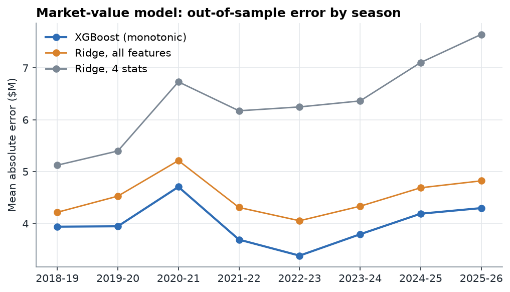
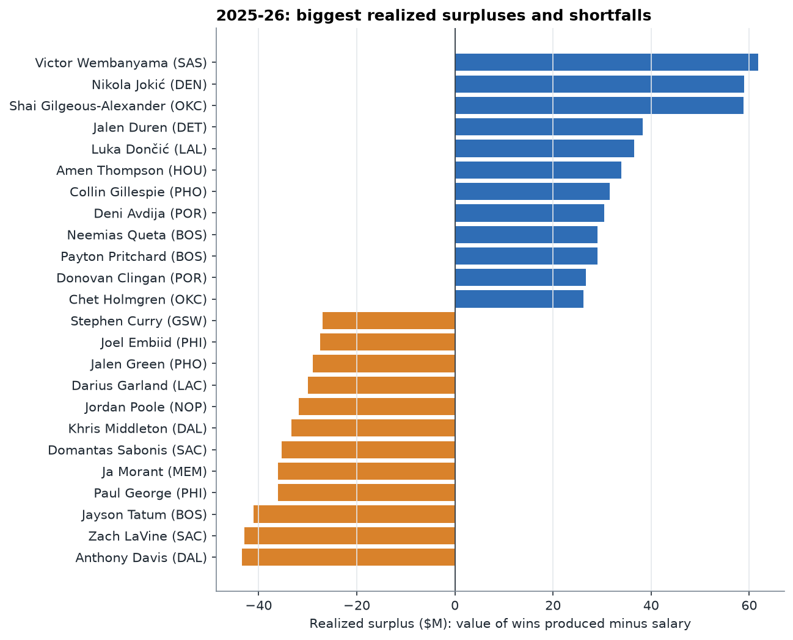
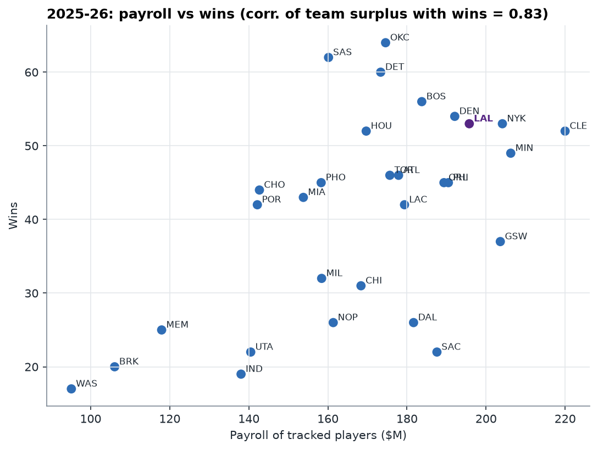
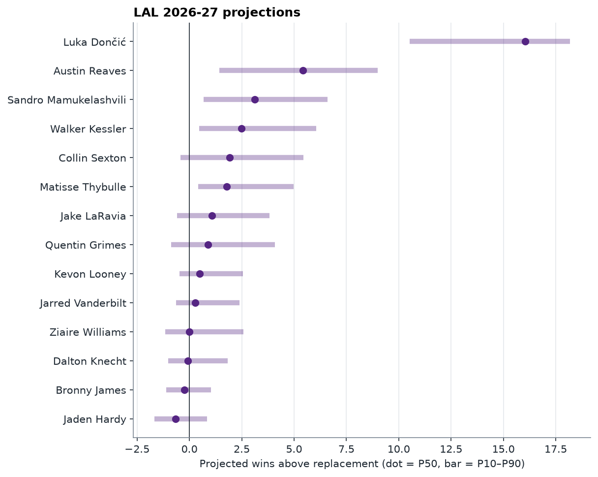

# Results — NBA Contract Value (2025-26 season, 2026-27 projections)

_Generated by `python -m ncv.pipeline`. Every number below comes from the run._

## Model validation (rolling-origin backtest, 2018-19 to 2025-26)

Each season is predicted by a model trained only on earlier seasons.

| Market-value model | MAE | R² | Rank corr. |
|---|---|---|---|
| XGBoost, monotonic (chosen) | $4.0M | 0.791 | 0.855 |
| Ridge, all features | $4.5M | 0.741 | 0.826 |
| Ridge, 4 core stats | $6.3M | 0.542 | 0.749 |

| Next-season WAR forecast | MAE (wins) |
|---|---|
| Quantile XGBoost (P50) | 1.46 |
| Marcel-style baseline | 1.57 |
| Last season carried forward | 1.69 |

- P10–P90 interval coverage: **79.5%** (target 80%); 10.8% of outcomes fell below P10, 9.7% above P90.
- Forecast beats Marcel in **every** backtest season.
- Salary join coverage for rotation players: 93.7%.
- League price of a win in 2025-26: $4.5M per WAR.

## 2025-26 value board

Realized surplus = what the player's wins were worth at the league's price of a win, minus salary. It counts availability, so injury-shortened seasons score low.

**Biggest veteran-contract bargains**

| Player | Team | Contract | Salary | Market value | Realized value | Realized surplus | Games |
|---|---|---|---|---|---|---|---|
| Nikola Jokić | DEN | Veteran | $55.2M | $51.7M | $114.2M | $59.0M | 65/82 |
| Shai Gilgeous-Alexander | OKC | Veteran | $38.3M | $40.3M | $97.2M | $58.8M | 68/82 |
| Luka Dončić | LAL | Veteran | $46.0M | $48.1M | $82.5M | $36.5M | 64/82 |
| Collin Gillespie | PHO | Veteran | $2.3M | $2.7M | $33.8M | $31.6M | 80/82 |
| Deni Avdija | POR | Veteran | $14.4M | $24.4M | $44.8M | $30.4M | 66/82 |
| Neemias Queta | BOS | Veteran | $2.3M | $4.3M | $31.4M | $29.1M | 76/82 |
| Payton Pritchard | BOS | Veteran | $7.2M | $17.6M | $36.3M | $29.0M | 79/82 |
| Sandro Mamukelashvili | TOR | Veteran | $2.5M | $4.3M | $27.8M | $25.3M | 80/82 |
| Tyrese Maxey | PHI | Veteran | $38.0M | $33.7M | $61.8M | $23.9M | 70/82 |
| Julian Champagnie | SAS | Veteran | $3.0M | $6.4M | $25.3M | $22.3M | 82/82 |

**Biggest rookie-scale bargains**

| Player | Team | Contract | Salary | Market value | Realized value | Realized surplus | Games |
|---|---|---|---|---|---|---|---|
| Victor Wembanyama | SAS | Rookie scale | $13.4M | $42.4M | $75.2M | $61.9M | 64/82 |
| Jalen Duren | DET | Rookie scale | $6.5M | $24.8M | $44.8M | $38.3M | 70/82 |
| Amen Thompson | HOU | Rookie scale | $9.7M | $22.6M | $43.6M | $33.9M | 79/82 |
| Donovan Clingan | POR | Rookie scale | $7.2M | $9.3M | $33.8M | $26.7M | 77/82 |
| Chet Holmgren | OKC | Rookie scale | $13.7M | $27.5M | $39.9M | $26.2M | 69/82 |
| Ausar Thompson | DET | Rookie scale | $8.8M | $6.9M | $31.4M | $22.6M | 73/82 |
| Reed Sheppard | HOU | Rookie scale | $10.6M | $6.7M | $32.6M | $22.0M | 82/82 |
| Dyson Daniels | ATL | Rookie scale | $7.7M | $20.3M | $27.8M | $20.1M | 76/82 |
| Kel'el Ware | MIA | Rookie scale | $4.4M | $7.5M | $24.1M | $19.7M | 77/82 |
| Cason Wallace | OKC | Rookie scale | $5.8M | $11.9M | $22.9M | $17.1M | 77/82 |

**Largest shortfalls**

| Player | Team | Contract | Salary | Market value | Realized value | Realized surplus | Games |
|---|---|---|---|---|---|---|---|
| Anthony Davis | DAL | Veteran | $54.1M | $50.8M | $10.7M | −$43.4M | 20/82 ⚕ |
| Zach LaVine | SAC | Veteran | $47.5M | $41.4M | $4.6M | −$42.9M | 39/82 ⚕ |
| Jayson Tatum | BOS | Veteran | $54.1M | $50.8M | $13.1M | −$41.0M | 16/82 ⚕ |
| Paul George | PHI | Veteran | $51.7M | $36.0M | $15.6M | −$36.1M | 37/82 ⚕ |
| Ja Morant | MEM | Veteran | $39.4M | $44.9M | $3.4M | −$36.0M | 20/82 ⚕ |
| Domantas Sabonis | SAC | Veteran | $42.3M | $48.9M | $7.1M | −$35.3M | 19/82 ⚕ |
| Khris Middleton | DAL | Veteran | $33.3M | $17.5M | $0.0M | −$33.3M | 63/82 |
| Jordan Poole | NOP | Veteran | $31.8M | $23.9M | $0.0M | −$31.8M | 39/82 ⚕ |
| Darius Garland | LAC | Veteran | $39.4M | $29.8M | $9.5M | −$29.9M | 45/82 |
| Jalen Green | PHO | Veteran | $33.6M | $31.9M | $4.6M | −$29.0M | 32/82 ⚕ |

_⚕ = injury-shortened: played under 50% of his team's games at a rotation pace (or was a 1,000+ minute player the year before). It means he missed most of the season, not that an injury was confirmed._

**Biggest availability costs** (value lost to missed games, valued at healthy pace)

| Player | Team | Games | Realized value | Healthy-pace value | Availability cost | Salary |
|---|---|---|---|---|---|---|
| Jayson Tatum | BOS | 16/82 | $13.1M | $63.0M | $49.8M | $54.1M |
| Giannis Antetokounmpo | MIL | 36/82 | $38.7M | $88.4M | $49.7M | $54.1M |
| Anthony Davis | DAL | 20/82 | $10.7M | $47.6M | $36.9M | $54.1M |
| Domantas Sabonis | SAC | 19/82 | $7.1M | $39.7M | $32.6M | $42.3M |
| Jimmy Butler | GSW | 38/82 | $30.2M | $61.5M | $31.3M | $54.1M |
| Tyler Herro | MIA | 33/82 | $15.6M | $38.2M | $22.6M | $31.0M |
| Franz Wagner | ORL | 34/82 | $16.8M | $39.2M | $22.4M | $38.7M |
| Jalen Williams | OKC | 33/82 | $14.4M | $36.7M | $22.3M | $6.6M |
| Joel Embiid | PHI | 38/82 | $27.8M | $49.6M | $21.9M | $55.2M |
| Kristaps Porziņģis | GSW | 32/82 | $11.9M | $33.0M | $21.1M | $30.7M |

## Team efficiency

Correlation of team realized surplus with wins: **0.83**; of team WAR with wins: **0.96** (a check that the value scale tracks winning).

| Team | Wins | Tracked payroll | WAR | Realized surplus | Payroll per WAR |
|---|---|---|---|---|---|
| OKC | 64 | $174.6M | 58.9 | $119.3M | $3.0M |
| SAS | 62 | $160.2M | 49.4 | $91.1M | $3.2M |
| DET | 60 | $173.3M | 49.4 | $77.9M | $3.5M |
| HOU | 52 | $169.7M | 42.4 | $53.1M | $4.0M |
| BOS | 56 | $183.7M | 47.0 | $52.2M | $3.9M |
| NYK | 53 | $204.1M | 47.8 | $42.5M | $4.3M |
| POR | 42 | $142.2M | 33.2 | $36.1M | $4.3M |
| DEN | 54 | $192.1M | 41.8 | $29.3M | $4.6M |
| MIA | 43 | $153.8M | 32.9 | $20.3M | $4.7M |
| PHO | 45 | $158.3M | 32.9 | $16.5M | $4.8M |
| CLE | 52 | $220.0M | 45.1 | $14.3M | $4.9M |
| TOR | 46 | $175.7M | 34.8 | $12.6M | $5.0M |
| CHO | 44 | $142.7M | 27.0 | $4.9M | $5.3M |
| LAL | 53 | $195.8M | 36.7 | $2.5M | $5.3M |
| ATL | 46 | $177.9M | 29.4 | −$7.9M | $6.0M |
| MIN | 49 | $206.2M | 36.4 | −$12.9M | $5.7M |
| ORL | 45 | $189.4M | 30.2 | −$24.5M | $6.3M |
| BRK | 20 | $106.1M | 8.4 | −$26.9M | $12.7M |
| MEM | 25 | $118.0M | 8.9 | −$37.8M | $13.2M |
| UTA | 22 | $140.5M | 11.3 | −$40.9M | $12.4M |
| GSW | 37 | $203.6M | 29.2 | −$41.4M | $7.0M |
| IND | 19 | $138.0M | 10.8 | −$43.6M | $12.8M |
| PHI | 45 | $190.5M | 23.8 | −$43.9M | $8.0M |
| LAC | 42 | $179.4M | 23.2 | −$46.7M | $7.7M |
| WAS | 17 | $95.1M | 0.0 | −$48.4M | $95.1M |
| MIL | 32 | $158.4M | 5.4 | −$61.5M | $29.3M |
| CHI | 31 | $168.4M | 7.6 | −$69.5M | $22.3M |
| NOP | 26 | $161.4M | 11.9 | −$73.0M | $13.6M |
| DAL | 26 | $181.7M | 7.8 | −$95.7M | $23.2M |
| SAC | 22 | $187.6M | 2.4 | −$136.2M | $77.2M |

## Which roles the market misprices

Gap between realized production value and the out-of-sample market price, veterans with 500+ minutes, all backtest seasons. Positive = the market under-prices that role's output. Caveat: production value is box-score based (VORP), which tends to credit on-ball and rim roles more than off-ball shooting and defense.

| Archetype | Player-seasons | Mean gap (% cap) | 90% CI | 2025-26 examples |
|---|---|---|---|---|
| Primary creator | 254 | 4.08 | [2.44, 5.71] | Kevin Durant, Tyrese Maxey, Jamal Murray, Julius Randle |
| Rim-running big | 181 | 1.62 | [0.74, 2.46] | Rudy Gobert, Deandre Ayton, Neemias Queta, Moussa Diabaté |
| Point-of-attack defender | 187 | 0.21 | [-0.50, 0.92] | Kris Dunn, OG Anunoby, Bruce Brown, Marcus Smart |
| Secondary playmaker | 147 | -1.56 | [-2.35, -0.77] | Ryan Rollins, Davion Mitchell, Josh Hart, Draymond Green |
| Spot-up shooter | 428 | -1.62 | [-2.07, -1.18] | Toumani Camara, Mikal Bridges, Donte DiVincenzo, A.J. Green |
| Two-way forward | 292 | -1.64 | [-2.30, -0.99] | Miles Bridges, Bam Adebayo, Jaden McDaniels, Onyeka Okongwu |
| Interior hub big | 148 | -1.64 | [-2.75, -0.53] | Scottie Barnes, Alperen Şengün, Karl-Anthony Towns, Evan Mobley |
| Scoring guard | 314 | -4.59 | [-5.29, -3.90] | Desmond Bane, Derrick White, Brandon Ingram, Nickeil Alexander-Walker |

## 2026-27 projections

Value of the P10/P50/P90 WAR forecast at the recent league price of a win, compared with actual 2026-27 salaries (Spotrac snapshot) where available. Teams are current rosters from the same snapshot.

**Highest projected surplus (P50)**

| Player | Team | Salary | Age | WAR P10/P50/P90 | Projected value (P50) | Surplus P10 / P50 |
|---|---|---|---|---|---|---|
| Shai Gilgeous-Alexander | OKC | $40.8M | 28 | 7.1 / 19.3 / 25.3 | $99.3M | −$2.7M / $58.5M |
| Victor Wembanyama | SAS | $16.9M | 23 | 7.0 / 13.6 / 18.9 | $70.8M | $20.8M / $53.9M |
| Nikola Jokić | DEN | $59.0M | 31 | 10.6 / 20.2 / 25.2 | $103.8M | −$3.3M / $44.8M |
| Amen Thompson | HOU | $12.3M | 24 | 4.6 / 9.2 / 13.0 | $48.8M | $13.0M / $36.5M |
| LeBron James | PHI | $3.9M | 42 | 3.5 / 7.4 / 11.6 | $39.5M | $16.3M / $35.6M |
| Luka Dončić | LAL | $49.5M | 27 | 10.5 / 16.0 / 18.2 | $82.9M | $5.8M / $33.4M |
| Kon Knueppel | CHO | $10.5M | 21 | 2.8 / 7.9 / 12.5 | $42.2M | $6.0M / $31.7M |
| Deni Avdija | POR | $13.1M | 26 | 3.3 / 7.3 / 10.8 | $39.2M | $5.8M / $26.0M |
| Donovan Clingan | POR | $7.5M | 22 | 2.1 / 5.7 / 9.0 | $30.9M | $5.6M / $23.4M |
| Cooper Flagg | DAL | $14.5M | 20 | 2.9 / 6.8 / 10.5 | $36.5M | $2.3M / $22.0M |
| Payton Pritchard | BOS | $7.8M | 29 | 1.9 / 5.2 / 9.1 | $28.4M | $4.2M / $20.6M |
| Neemias Queta | BOS | $2.7M | 27 | 1.6 / 4.1 / 6.7 | $23.2M | $8.0M / $20.5M |
| Kel'el Ware | MIL | $4.7M | 22 | 1.3 / 4.4 / 7.7 | $24.3M | $4.2M / $19.7M |
| Moussa Diabaté | CHO | $2.5M | 25 | 0.7 / 3.5 / 6.7 | $19.8M | $3.3M / $17.3M |
| Reed Sheppard | HOU | $11.1M | 22 | 2.0 / 5.2 / 8.9 | $28.4M | $1.3M / $17.3M |

### LAL 2026-27 roster

Too few NBA minutes for a projection (rookies, two-way and deep-bench players): Cameron Carr, Adou Thiero, AK Okereke, Arthur Kaluma, Chris Manon.

| Player | Age | Archetype | WAR P10 / P50 / P90 | Value (P50) | Salary | Surplus (P50) | Market value | Top drivers of market value |
|---|---|---|---|---|---|---|---|---|
| Luka Dončić | 27 | Primary creator | 10.5 / 16.0 / 18.2 | $82.9M | $49.5M | $33.4M | $53.5M | Points per game (last season) (+5.2% cap); Minutes per game (last season) (+3.8% cap); Points per game (two seasons ago) (+3.1% cap) |
| Austin Reaves | 28 | Primary creator | 1.4 / 5.4 / 9.0 | $29.7M | $41.2M | −$11.5M | $31.1M | Points per game (last season) (+3.7% cap); Points per game (two seasons ago) (+2.7% cap); Minutes per game (last season) (+2.6% cap) |
| Sandro Mamukelashvili | 27 | Two-way forward | 0.7 / 3.1 / 6.6 | $18.1M | $13.0M | $5.1M | $10.0M | Points per game (two seasons ago) (−1.3% cap); Minutes per game (last season) (−1.2% cap); Points per game (last season) (−0.9% cap) |
| Walker Kessler | 25 | Rim-running big | 0.5 / 2.5 / 6.1 | $14.9M | $30.1M | −$15.2M | $28.0M | Minutes per game (last season) (+2.5% cap); Share of games started (+2.0% cap); Points per game (last season) (+1.6% cap) |
| Collin Sexton | 28 | Primary creator | -0.4 / 1.9 / 5.5 | $12.1M | $9.4M | $2.8M | $17.8M | Points per game (last season) (+2.4% cap); Points per game (two seasons ago) (+2.1% cap); Share of games started (−1.1% cap) |
| Matisse Thybulle | 29 | Point-of-attack defender | 0.4 / 1.8 / 5.0 | $11.4M | $3.3M | $8.1M | $9.0M | Minutes per game (last season) (−1.7% cap); Points per game (last season) (−1.4% cap); Points per game (two seasons ago) (−1.1% cap) |
| Jake LaRavia | 25 | Point-of-attack defender | -0.6 / 1.1 / 3.8 | $7.9M | $6.0M | $1.9M | $11.0M | Points per game (last season) (−1.1% cap); Points per game (two seasons ago) (−1.1% cap); Share of games started (−0.6% cap) |
| Quentin Grimes | 26 | Scoring guard | -0.9 / 0.9 / 4.1 | $6.9M | $14.0M | −$7.0M | $20.1M | Minutes per game (last season) (+2.0% cap); Points per game (two seasons ago) (+1.3% cap); Career All-Star selections (−0.9% cap) |
| Kevon Looney | 30 | Interior hub big | -0.5 / 0.5 / 2.6 | $4.9M | $3.9M | $1.0M | $9.9M | Minutes per game (last season) (−1.7% cap); Points per game (last season) (−1.3% cap); Points per game (two seasons ago) (−1.2% cap) |
| Jarred Vanderbilt | 27 | Point-of-attack defender | -0.6 / 0.3 / 2.4 | $3.9M | $12.4M | −$8.6M | $6.9M | Minutes per game (last season) (−1.6% cap); Points per game (last season) (−1.4% cap); Points per game (two seasons ago) (−1.1% cap) |
| Ziaire Williams | 25 | Point-of-attack defender | -1.1 / 0.0 / 2.6 | $2.5M | $2.8M | −$0.4M | $8.3M | Points per game (last season) (−1.2% cap); Points per game (two seasons ago) (−0.9% cap); Share of games started (−0.7% cap) |
| Dalton Knecht | 25 | Spot-up shooter | -1.0 / -0.1 / 1.8 | $2.1M | $4.2M | −$2.1M | $5.1M | Minutes per game (last season) (−1.6% cap); Points per game (last season) (−1.4% cap); Points per game (two seasons ago) (−1.0% cap) |
| Bronny James | 22 | Secondary playmaker | -1.1 / -0.2 / 1.0 | $1.3M | $2.3M | −$1.0M | $2.5M | Minutes per game (last season) (−1.7% cap); Points per game (last season) (−1.4% cap); Points per game (two seasons ago) (−1.1% cap) |
| Jaden Hardy | 24 | Scoring guard | -1.7 / -0.6 / 0.8 | $0.0M | $6.0M | −$6.0M | $4.4M | Minutes per game (last season) (−1.6% cap); Points per game (last season) (−1.3% cap); Points per game (two seasons ago) (−1.0% cap) |

